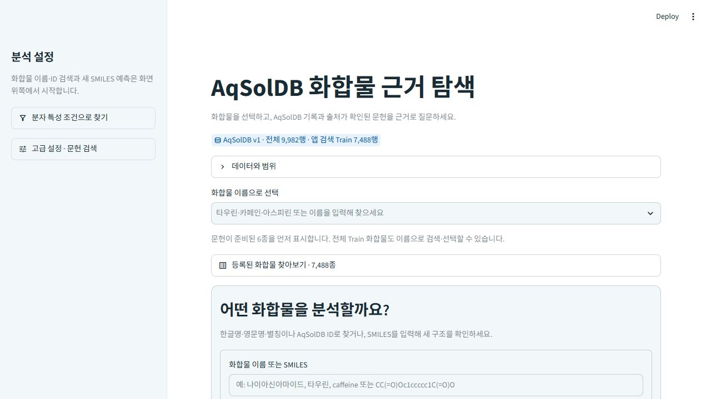
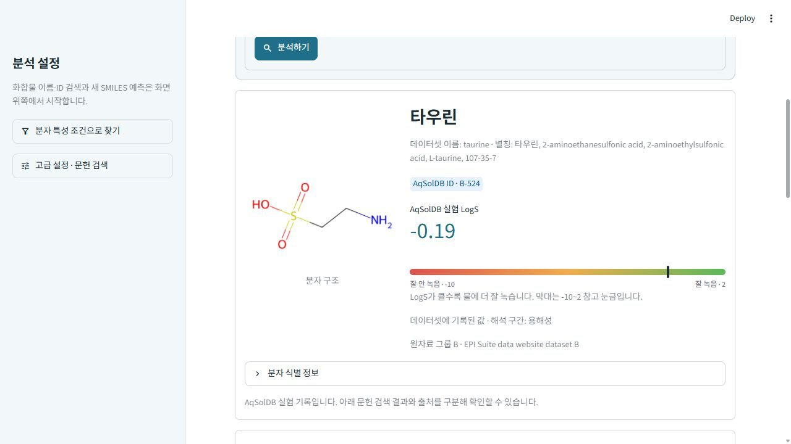
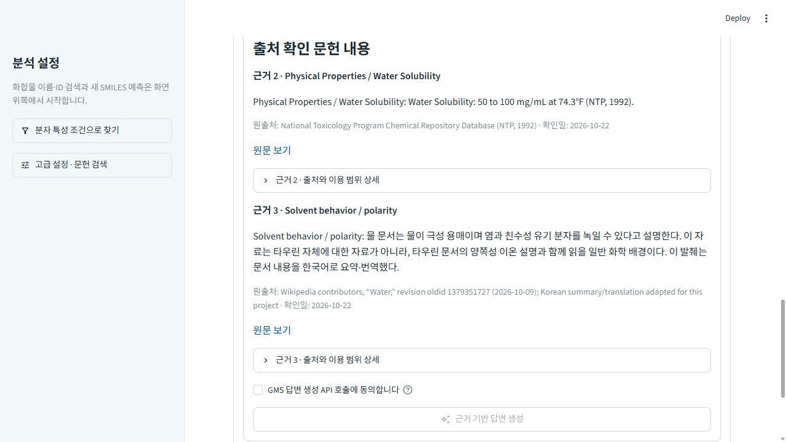

# 스크린샷 증빙

## 2026-10-23 수정 후 화면

이번 캡처는 실행 중인 Streamlit 앱에서 직접 저장했다. 생성 답변과 벡터 검색은 이번에 재실행하지 않았다.

| 파일 | 확인 내용 | 체크리스트 |
|---|---|---|
| [첫 화면](../screenshots/16_home_updated.jpg) | 테마, 검색 카드, 접힌 데이터 범위 안내 | 26 |
| [타우린 결과](../screenshots/17_taurine_updated.jpg) | 한글 검색, 분자 구조, 실험 LogS와 참고 눈금 | 10·26 |
| [문헌 근거](../screenshots/18_local_evidence_updated.jpg) | 수용해도 원문, 단위·온도, 원출처 링크 | 8·24·26 |

## 기존 기능 검증 화면

아래는 UI 수정 전 저장된 증빙이다. 최신 화면으로 표시하지 않는다. 상세 실행 내용과 제한은 [체크리스트](../체크리스트.pdf), [검증 결과](06_검증_결과.md)를 따른다.

| 파일 | 확인 내용 | 체크리스트 |
|---|---|---|
| [벡터 검색](../screenshots/10_taurine_vector_evidence.png) | 의미 검색 결과 | 6·8 |
| [생성 답변](../screenshots/11_taurine_answer_ui.png) | 답변과 근거 번호 | 7·8 |
| [문헌 기록 비교](../screenshots/12_measurement_comparison.png) | 실험 기록과 문헌값의 조건 구분 | 12 |
| [키 없음](../screenshots/13_missing_key_notice.png) | 키 누락 안내 | 13·21 |
| [색인 없음](../screenshots/14_empty_index_notice.png) | 빈 색인 안내 | 13 |
| [조건 검색](../screenshots/05_condition_search.png) | 수치 조건 탐색 | 11 |

PDF 첫 4쪽은 원본 양식을 그대로 사용해 결과·증빙·비고를 기입하고 위 화면을 부록으로 포함한다. 부록 10에는 실제 LangGraph 구성 코드를 넣었다. 앱 작성자·셀프 점검자는 김지은(서울 08반)이다. 1인 프로젝트이므로 요청에 따라 별도 상호 점검 양식은 제외했다.
